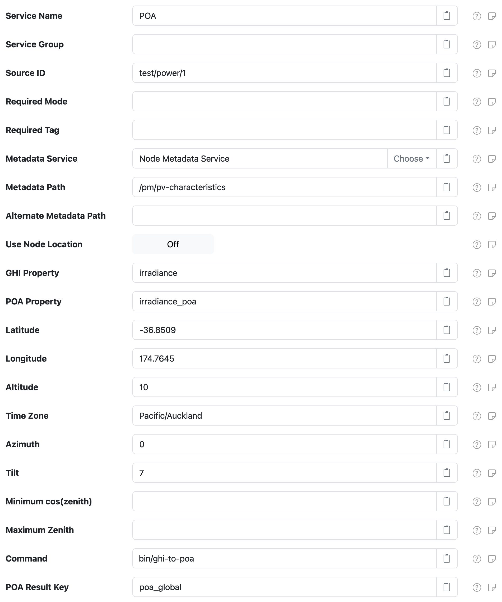

# pvlib GHI to POA Calculator Datum Filter

Inject a **plane-of-array** (POA) irradiance property based on a set of PV characteristics
and a measured **global horizontal irradiance** (GHI) property value, using the [pvlib][pvlib]
library.

# Use

Once installed, a new **POA Irradiance Calculator (pvlib)** component will appear on the
**Settings > Datum Filter** page on your SolarNode. Click on the **Manage** button to configure
filters.

The general idea on how to use this filter can be used can be outlined like this:

1. You have a GHI irradiance measurement property collected by some source ID
2. You configure this filter to process that same source ID, telling it which property is the GHI
   measurement and configuring all the PV characteristics necessary for deriving a POA irradiance
   values from the GHI values.
3. Instead of configuring the PV characteristics on this filter itself, you can alternatively
   configure them in datum, node, or user metadata. See the
   [Metadata Parameters](#metadata-parameters) section for more details.



# Settings

Each filter configuration contains the following overall settings:

| Setting                 | Description                                                                                                                                                                                                                                                                                                         |
|:------------------------|:--------------------------------------------------------------------------------------------------------------------------------------------------------------------------------------------------------------------------------------------------------------------------------------------------------------------|
| Service Name            | A unique ID for the filter, to be referenced by other components.                                                                                                                                                                                                                                                   |
| Service Group           | An optional service group name to assign.                                                                                                                                                                                                                                                                           |
| Source ID               | The source ID(s) to filter.                                                                                                                                                                                                                                                                                         |
| Required Mode           | If configured, an [operational mode][opmodes] that must be active for this filter to be applied.                                                                                                                                                                                                                    |
| Required Tag            | Only apply the filter on datum with the given tag. A tag may be prefixed with `!` to invert the logic so that the filter only applies to datum **without** the given tag. Multiple tags can be defined using a `,` delimiter, in which case **at least one** of the configured tags must match to apply the filter. |
| Metadata Service        | The **Service Name** of the Metadata Service to obtain the PV parameters from. See [Metadata Parameters](#metadata-parameters) for more information.                                                                                                                                                                |
| Metadata Path           | The [metadata path][meta-path] that will resolve the PV parameters from the configured **Metadata Service**. See [Metadata Parameters](#metadata-parameters) for more information.                                                                                                                                  |
| Alternate Metadata Path | An alternate [metadata path][meta-path] to resolve the PV parameters from the configured **Metadata Service**. See [Metadata Parameters](#metadata-parameters) for more information.                                                                                                                                |
| Use Node Location       | If enabled, then the location configured for this node in SolarNetwork will be used in preference to the **Latitude**, **Longitude**, and **Altitude** settings configured on this filter.                                                                                                                          |
| GHI Property            | The name of the datum property to obtain the GHI irradiance value from, to use in the **POA Property** calculation.                                                                                                                                                                                                 |
| POA Property            | The name of the datum property to populate with the calculated POA irradiance values.                                                                                                                                                                                                                               |
| Latitude                | The decimal latitude of the PV system.                                                                                                                                                                                                                                                                              |
| Longitude               | The decimal longitude of the PV system.                                                                                                                                                                                                                                                                             |
| Altitude                | The altitude of the PV system, in meters above sea level.                                                                                                                                                                                                                                                           |
| Time Zone               | The identifier of the time zone of the PV system, for example `Pacific/Auckland`. If not specified then the system default zone will be used.                                                                                                                                                                       |
| Azimuth                 | The angle of the PV array in degrees clockwise from true north that the PV system is facing.                                                                                                                                                                                                                        |
| Tilt                    | The angle of the PV array in degrees from horizontal, from `0` (facing directly upwards) to `90` (facing the horizon).                                                                                                                                                                                              |
| Minimum cos(zenith)     | The minimum value of `cos(zenith)` to allow when calculating the global clearness index.                                                                                                                                                                                                                            |
| Maximum Zenith          | The maximum zenith value to allow in DNI calculation.                                                                                                                                                                                                                                                               |
| Tracking                | If enabled, model a single-axis tracker: the **Tilt** and **Azimuth** settings are ignored and the panel orientation is calculated from the sun position and the tracker axis settings.                                                                                                                             |
| Axis Tilt               | The tilt of the tracker axis in degrees from horizontal. Defaults to `0`.                                                                                                                                                                                                                                           |
| Axis Azimuth            | The angle of the tracker axis in degrees clockwise from true north, for example `0` for a north-south axis. Defaults to `0`.                                                                                                                                                                                        |
| Maximum Angle           | The maximum tracker rotation angle in degrees from horizontal. Defaults to `90`.                                                                                                                                                                                                                                    |
| Backtrack               | If enabled, apply backtracking to avoid row-to-row shading, using the **Ground Coverage Ratio**.                                                                                                                                                                                                                    |
| Ground Coverage Ratio   | The ratio of PV row width to row spacing, used when **Backtrack** or **Bifacial** is enabled. Defaults to `0.2857`. Set a realistic value in bifacial mode, as the default overstates the rear-side gain.                                                                                                           |
| Bifacial                | If enabled, model bifacial modules in long rows on flat ground: the POA irradiance then includes the rear-side irradiance, weighted by the **Bifaciality** and loss factors.                                                                                                                                        |
| Bifaciality             | The ratio of rear to front module efficiency, from `0` to `1`, used when **Bifacial** is enabled. Defaults to `0.8`.                                                                                                                                                                                                |
| Albedo                  | The fraction of irradiance reflected by the ground, from `0` to `1`, for example `0.2` for grass or `0.8` for fresh snow. Defaults to `0.25`. Requires an updated **Command**.                                                                                                                                      |
| Row Height              | The height of the PV row center above the ground, in the same units as **Row Pitch**, greater than `0` up to `100`, used when **Bifacial** is enabled. Defaults to `1.5`.                                                                                                                                           |
| Row Pitch               | The distance between adjacent PV rows, in the same units as **Row Height**, greater than `0` up to `1000`, used when **Bifacial** is enabled. Defaults to `5`.                                                                                                                                                      |
| Shade Factor            | The fractional rear-side irradiance loss from shading by the mounting structure, from `-1` to `0`, used when **Bifacial** is enabled. Defaults to `-0.02`.                                                                                                                                                          |
| Transmission Factor     | The fractional rear-side irradiance loss from module features such as the junction box, from `-1` to `0`, used when **Bifacial** is enabled. Defaults to `0`.                                                                                                                                                       |
| Transposition Model     | The transposition model name to use. See [pvlib][pvlib-transpose] for more info.                                                                                                                                                                                                                                    |
| Command                 | The external command to run, where the parameters and GHI irradiance will be passed as arguments and the calculated POA irradiance is returned. See [Command](#command) below.                                                                                                                                      |
| Command Timeout         | The maximum number of seconds to wait for the **Command** to finish, after which it is stopped. Set to `0` to wait forever.                                                                                                                                                                                         |
| POA Result Key          | The command result key to extract for the calculated POA irradiance value. When **Bifacial** is enabled, `poa_global` includes the weighted rear-side irradiance; use `poa_front` for the front-side value, for example to compare with a POA sensor.                                                               |
| Expressions             | A list of expression configurations that are evaluated to derive datum property values from the **Command** output. See [Expressions](#expressions) below.                                                                                                                                                          |

# Metadata Parameters

This filter can look up the PV characteristics from SolarNetwork [metadata][metadata]. If either
**Metadata Path** or **Alternate Metadata Path** are configured, then the filter will look for a
metadata object with properties as shown below, first from the datum metadata associated with the
source ID of the datum being filtered and then from any configured **Metadata Service**.

For example, a **Metadata Path** of `/pm/pv-characteristics` would work with metadata like
this:

```json
{
	"pm": {
		"pv-characteristics": {
			"lat": 41.18015,
			"lon": -73.8328,
			"alt": 10,
			"zone": "America/New_York",
			"pvArrayTilt": 7,
			"pvArrayAzimuth": 205,
			"minCosZenith": 3,
			"maxZenith": 83,
			"tracking": true,
			"pvAxisTilt": 0,
			"pvAxisAzimuth": 0,
			"maxAngle": 60,
			"backtrack": true,
			"gcr": 0.35,
			"bifacial": true,
			"bifaciality": 0.7,
			"albedo": 0.2,
			"pvRowHeight": 2,
			"pvRowPitch": 5.7,
			"shadeFactor": -0.02,
			"transmissionFactor": 0
		}
	}
}
```

The filter merges all possible PV characteristics from the settings on the filter itself and
metadata, in the following order, with **later sources overriding** earlier sources:

1. Filter settings
2. Metdata from the configured **Metadata Service**
3. Datum metadata associated with the source ID of the datum being filtered
4. **Latitude, longitude, and altitude** from the location configured for the node in SolarNetwork,
   if **Use Node Location** is enabled

The supported metadata parameters are:

| Metadata Key         | Description                                                                                                                                             |
|:---------------------|:--------------------------------------------------------------------------------------------------------------------------------------------------------|
| `lat`                | Decimal latitude of the PV system                                                                                                                       |
| `lon`                | Decimal longitude of the PV system                                                                                                                      |
| `alt`                | Altitude of the PV system, in meters above sea level                                                                                                    |
| `zone`               | Time zone identifier of the PV system, for example `Pacific/Auckland`                                                                                   |
| `pvArrayTilt`        | PV array tilt angle value, in degrees from horizontal                                                                                                   |
| `pvArrayAzimuth`     | PV array angle value, in degrees clockwise from north                                                                                                   |
| `minCosZenith`       | Minimum value of `cos(zenith)` to allow when calculating global clearness index                                                                         |
| `maxZenith`          | Maximum zenith value to allow in DNI calculation                                                                                                        |
| `transpositionModel` | The transposition model name to use, one of `haydavies` or `perez-driesse`; defaults to `haydavies`                                                     |
| `tracking`           | `true` to model a single-axis tracker, in which case `pvArrayTilt` and `pvArrayAzimuth` are ignored; defaults to `false`                                |
| `pvAxisTilt`         | Tracker axis tilt angle value, in degrees from horizontal, between `0` and `90`; defaults to `0`                                                        |
| `pvAxisAzimuth`      | Tracker axis angle value, in degrees clockwise from north, between `0` and `360`; defaults to `0`                                                       |
| `maxAngle`           | Maximum tracker rotation angle value, in degrees from horizontal, greater than `0` up to `180`; defaults to `90`                                        |
| `backtrack`          | `true` to apply backtracking to avoid row-to-row shading, using `gcr`; defaults to `false`                                                              |
| `gcr`                | Ground coverage ratio (PV row width to row spacing), used for backtracking and bifacial mode, greater than `0` up to `1`; defaults to `0.2857`          |
| `bifacial`           | `true` to model bifacial modules, in which case the POA irradiance includes the rear side; defaults to `false`                                          |
| `bifaciality`        | Ratio of rear to front module efficiency, used in bifacial mode, between `0` and `1`; defaults to `0.8`                                                 |
| `albedo`             | Fraction of irradiance reflected by the ground, between `0` and `1`; defaults to `0.25`                                                                 |
| `pvRowHeight`        | Height of the PV row center above the ground, in the same units as `pvRowPitch`, used in bifacial mode, greater than `0` up to `100`; defaults to `1.5` |
| `pvRowPitch`         | Distance between adjacent PV rows, in the same units as `pvRowHeight`, used in bifacial mode, greater than `0` up to `1000`; defaults to `5`            |
| `shadeFactor`        | Fractional rear-side irradiance loss from shading by the mounting structure, used in bifacial mode, between `-1` and `0`; defaults to `-0.02`           |
| `transmissionFactor` | Fractional rear-side irradiance loss from module features such as the junction box, used in bifacial mode, between `-1` and `0`; defaults to `0`        |

# Expressions

Any number of [expressions][expr] can be configured on the **Expression** list. Expressions can
reference datum properties as usually, and additionally any properties returned by the configured
[command](#command). For example, the [def/ghi-to-poa.py](./def/ghi-to-poa.py) script returns
many properties, like these:

```json
{
	"date": "2024-11-18T10:24:47",
	"zone": "Pacific/Auckland",
	"ghi": 805.0,
	"dni": 844.5952562517782,
	"dhi": 151.71952235515488,
	"zenith": 39.3322587975266,
	"azimuth": 74.67509718383894,
	"min_cos_zenith": 0.065,
	"max_zenith": 87,
	"poa_global": 799.951169881113,
	"poa_direct": 648.6170024103126,
	"poa_diffuse": 151.3341674708004,
	"poa_sky_diffuse": 150.9512589662823,
	"poa_ground_diffuse": 0.38290850451810454
}
```

When **Tracking** is enabled the result also includes the calculated tracker orientation
properties `tracker_theta`, `aoi`, `surface_tilt`, and `surface_azimuth`.

Properties like `poa_global`, `poa_direct`, and so on can be used in expressions, for example you
could round the `poa_global` value to at most 3 digits with:

```
roundDown(poa_global, 3)
```

# Command

The **Command** setting is the system-specific path to the command to run, where the parameters and GHI irradiance will be passed as arguments and the calculated POA irradiance is returned. The
command must accept the options shown below, and is expected to output a JSON object. The
[def/ghi-to-poa.py](./def/ghi-to-poa.py) script is an example of such a command.

| Command Option          | Description                                                                                                                                                                                   |
|:------------------------|:----------------------------------------------------------------------------------------------------------------------------------------------------------------------------------------------|
| `--latitude`            | The decimal latitude                                                                                                                                                                          |
| `--longitude`           | The decimal longitude                                                                                                                                                                         |
| `--altitude`            | The altitude in meters above sea level                                                                                                                                                        |
| `--zone`                | Time zone identifier, for example `Pacific/Auckland`                                                                                                                                          |
| `--array-tilt`          | PV tilt angle value, in degrees from horizontal                                                                                                                                               |
| `--array-azimuth`       | PV array angle value, in degrees clockwise from north                                                                                                                                         |
| `--min-cos-zenith`      | Minimum value of `cos(zenith)` to allow when calculating global clearness index                                                                                                               |
| `--max-zenith`          | Maximum zenith value to allow in DNI calculation                                                                                                                                              |
| `--date`                | Local timestamp, in `YYYY-MM-DDTHH:mm:ss` format                                                                                                                                              |
| `--irradiance`          | The GHI irradiance to calculate the POA irradiance value for                                                                                                                                  |
| `--transpose`           | The optional transposition model name to use, for example `haydavies`                                                                                                                         |
| `--tracking`            | `true` to model a single-axis tracker, in which case `--array-tilt` and `--array-azimuth` are ignored; defaults to `false`                                                                    |
| `--axis-tilt`           | Tracker axis tilt angle value, in degrees from horizontal, between `0` and `90`; defaults to `0`; must be `0` in bifacial mode                                                                |
| `--axis-azimuth`        | Tracker axis angle value, in degrees clockwise from north, between `0` and `360`; defaults to `0`                                                                                             |
| `--max-angle`           | Maximum tracker rotation angle value, in degrees from horizontal, greater than `0` up to `180`; defaults to `90`                                                                              |
| `--backtrack`           | `true` to apply backtracking to avoid row-to-row shading, using `--gcr`; defaults to `false`                                                                                                  |
| `--gcr`                 | Ground coverage ratio (PV row width to row spacing), used for backtracking and bifacial mode, greater than `0` up to `1`; defaults to `0.2857`                                                |
| `--bifacial`            | `true` to model bifacial modules, in which case `poa_global` includes the rear side; transposition models other than `haydavies` or `isotropic` fall back to `haydavies`; defaults to `false` |
| `--bifaciality`         | Ratio of rear to front module efficiency, used in bifacial mode, between `0` and `1`; defaults to `0.8`                                                                                       |
| `--albedo`              | Fraction of irradiance reflected by the ground, between `0` and `1`; defaults to `0.25`                                                                                                       |
| `--height`              | Height of the PV row center above the ground, in the same units as `--pitch`, used in bifacial mode, greater than `0` up to `100`; defaults to `1.5`                                          |
| `--pitch`               | Distance between adjacent PV rows, in the same units as `--height`, used in bifacial mode, greater than `0` up to `1000`; defaults to `5`                                                     |
| `--shade-factor`        | Fractional rear-side irradiance loss from shading by the mounting structure, used in bifacial mode, between `-1` and `0`; defaults to `-0.02`                                                 |
| `--transmission-factor` | Fractional rear-side irradiance loss from module features such as the junction box, used in bifacial mode, between `-1` and `0`; defaults to `0`                                              |

# Developer Setup

To work with the [def/ghi-to-poa.py](./def/ghi-to-poa.py) script, setup a Python virtual environment
one time, for example:

```sh
# create virtual environment
python3 -m venv ~/.python/venv/solarnode

# activate virtual environment
source ~/.python/venv/solarnode/bin/activate

# install deps
pip install pvlib
```

Each time you want to work with the environment in a new shell, execute

```sh
source ~/.python/venv/solarnode/bin/activate
```

You can execute the [ghi-to-poa.py](./def/ghi-to-poa.py) script like:

```sh
python def/ghi-to-poa.py --latitude -36.8509 --longitude 174.7645 \
  --zone Pacific/Auckland --array-tilt 2.5 --array-azimuth 170 \
  --date 2024-11-16T10:00 --irradiance 1000
```

Or with single-axis tracking enabled:

```sh
python def/ghi-to-poa.py --latitude -36.8509 --longitude 174.7645 \
  --zone Pacific/Auckland --tracking true --axis-azimuth 0 \
  --backtrack true --gcr 0.35 \
  --date 2024-11-16T10:00 --irradiance 1000
```

Or with bifacial modules on single-axis tracking:

```sh
python def/ghi-to-poa.py --latitude -36.8509 --longitude 174.7645 \
  --zone Pacific/Auckland --tracking true --axis-azimuth 0 \
  --backtrack true --gcr 0.35 \
  --bifacial true --bifaciality 0.7 --albedo 0.2 --height 2 --pitch 5.7 \
  --date 2024-11-16T10:00 --irradiance 1000
```

[expr]: https://solarnetwork.github.io/solarnode-handbook/users/expressions/
[metadata]: https://github.com/SolarNetwork/solarnetwork/wiki/SolarNet-API-global-objects#metadata
[meta-path]: https://github.com/SolarNetwork/solarnetwork/wiki/SolarNet-API-global-objects#metadata-filter-key-paths
[opmodes]: https://github.com/SolarNetwork/solarnetwork/wiki/SolarNode-Operational-Modes
[pvlib]: https://pvlib-python.readthedocs.io/
[pvlib-sheds]: https://pvlib-python.readthedocs.io/en/stable/reference/generated/pvlib.bifacial.infinite_sheds.get_irradiance.html
[pvlib-transpose]: https://pvlib-python.readthedocs.io/en/v0.10.4/reference/irradiance/transposition.html

